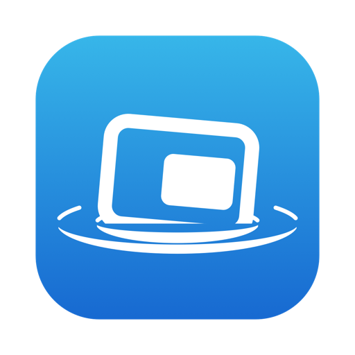

# FloatPiP

Watch one window in a small floating picture while you share your screen, without the people watching your share seeing it.

## What it is

FloatPiP is a small, free, open-source macOS menu bar app. Pick any window, such as a video call, and FloatPiP shows it live in a floating picture in a corner of your screen, on top of everything, on every desktop and over full-screen apps. macOS leaves the floating picture out of what you share (see [Left out of screen sharing](#left-out-of-screen-sharing)), so you can keep an eye on the call while you share something else.

## Privacy

- FloatPiP sees only the window you pick in macOS's own window picker, and only while it is floating. It needs no Screen Recording permission.
- Nothing is saved: each picture is drawn on screen and discarded.
- FloatPiP never goes online. No account, no analytics, no update checks.

## System requirements

macOS 26 or later, on a Mac with Apple silicon.

## Quick start

1. Download `FloatPiP-vX.Y.Z.zip` from the [Releases page](../../releases), open it, and drag FloatPiP to your Applications folder. (To build it yourself instead, see [BUILDING.md](BUILDING.md).)
2. Open FloatPiP. Because it isn't notarized by Apple yet, macOS may ask you to confirm the first time: choose **Open**, or go to System Settings ▸ Privacy & Security and choose **Open Anyway**.
3. macOS's window picker appears: click the window you want to float.

FloatPiP's icon, a small picture afloat on rippling water, appears in the menu bar, not the Dock.

## Options

Click the menu bar icon, or right-click the floating picture:

- **Pick a Window / Pick Another Window**: opens macOS's window picker; a new choice replaces the current window.
- **Stop**: closes the floating picture.
- **Corner**: top left, top right, bottom left, or bottom right (the default).
- **Size (Height of Screen)**: the picture's height as a share of the screen's height, from 10% to 90% (30% by default).
- **Shape**: Rounded (the default) and Rectangle (sharp corners) show the whole window, never stretched; Circle shows the middle of it.
- **Drag** the picture to move it. When you let go, it snaps to the nearest corner of the screen you dropped it on, as macOS's own picture in picture does.

FloatPiP remembers your choices. It stops by itself when the window closes, or when you stop it from macOS's screen-sharing icon in the menu bar.

## How it looks

The picture floats the way macOS and calling apps show floating video, with no border:

- It sits 3% of the screen's height in from the edges, clear of the menu bar and Dock.
- Rounded corners are 12% of the picture's height; a circle's radius is half its side.
- Two soft shadows lift it off the screen: a wide one (blur 10% of the picture's height, at least 4 points; 4% lower; 55% opacity) and a tight one (blur 2%, at least 1.5 points; 1% lower; 35%), with a white hairline 1 pixel wide at 35% opacity around the edge.

## Left out of screen sharing

FloatPiP's window is marked as one macOS must not share (`NSWindow.sharingType = .none`). On macOS 26.6.2 this was tested: the marked window was left out of a capture of the whole screen, while a window from the same app that was not marked was captured. See [docs/SHARING-TEST.md](docs/SHARING-TEST.md) for how it was tested, and what wasn't. When you share a single window rather than your whole screen, the floating picture isn't in it anyway.

A video-calling app may draw its own preview of what you share. Check the first time that the people watching don't see the picture.

## Light on the Mac

FloatPiP captures the window at the picture's own size, at most 30 frames a second, and only while it is showing.

## Contributing

Reports, ideas, and pull requests are welcome: see [CONTRIBUTING.md](CONTRIBUTING.md). Everyone taking part follows the [code of conduct](CODE_OF_CONDUCT.md). Security problems go through [SECURITY.md](SECURITY.md).

## License

FloatPiP is free software under the [GNU AGPL v3.0 only](LICENSE), and is also available under a commercial license: see [COMMERCIAL.md](COMMERCIAL.md). Use of the app is covered by the [terms of use](TERMS.md). The name and icon are covered by [TRADEMARKS.md](TRADEMARKS.md). All changes are in [CHANGELOG.md](CHANGELOG.md).
